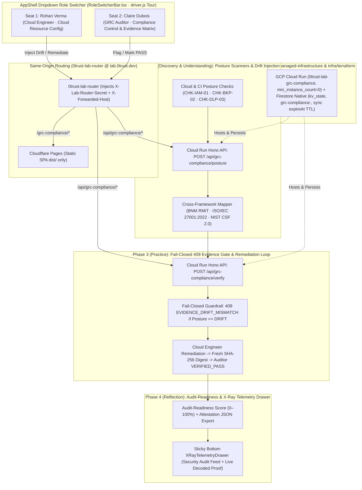

# Lab 8 Architecture: Continuous Compliance & BNM RMiT / ISO 27001 Mapper (`/grc-compliance`)

> **Zoom Level:** 2.5 (Lab Assembly + Infrastructure Mapping)  
> **Parent Overview:** [`0trust.dev/docs/ARCHITECTURE.md`](https://github.com/c2pig/0trust.dev/blob/main/docs/ARCHITECTURE.md)  
> **Experience Archetype:** Role-Specific AppShell (`Cloud Engineer` ↔ `GRC Auditor`) with `driver.js` Orientation Overlay  
> **Architecture SVG:** [`docs/diagrams/grc_compliance_architecture.svg`](diagrams/grc_compliance_architecture.svg)

---

## 1. End-to-End 2-Seat Continuous Compliance + `managed-infrastructure` Zoom-In

---

## 2. Distributed Repo & Infrastructure Ownership

| Lab Phase & Seat | Plain-English Purpose | Owning Application Repo | Provisioning Infrastructure |
| :--- | :--- | :--- | :--- |
| **Phase 1 (Discovery)**: Posture-to-Regulation Map | Map 3 live posture checks (`CHK-IAM-01`, `CHK-BKP-02`, `CHK-DLP-03`) to BNM RMiT, ISO/IEC 27001:2022, and NIST CSF 2.0 | [`0trust-lab-grc-compliance`](https://github.com/c2pig/0trust-lab-grc-compliance) (`src/contracts/grcComplianceContract.ts`) | `managed-infrastructure/modules/cloudflare-pages-lab` (static `dist/` SPA, `enable_custom_domain = false`, behind `0trust-lab-router` at `https://lab.0trust.dev/grc-compliance`) |
| **Phase 2 (Understanding · Seat 1 Cloud Engineer)**: Drift Injection | Inject Drift 8A (`IAM_MFA_BYPASS`), 8B (`BACKUP_WORM_DISABLED`), or 8C (`PII_UNMASKED`) via `POST /api/grc-compliance/posture` | [`0trust-lab-grc-compliance`](https://github.com/c2pig/0trust-lab-grc-compliance) (`server/runtime.ts`, `server/app.ts`, `functions/api/grc-compliance/posture.ts`) | `managed-infrastructure/modules/cloud-run-lab` (`0trust-lab-grc-compliance`, `min_instance_count = 0`) + Firestore Native (`kv_state` collection, `grc-compliance:lab8%3Agrc%3A<sid>`, `1h` synchronous `expireAt` TTL) |
| **Phase 3 (Practice · Seat 2 Auditor ↔ Seat 1 Cloud Engineer)**: 409 Trap & Remediation | Enforce fail-closed `409 EVIDENCE_DRIFT_MISMATCH` if Auditor tries `MARK_PASS` while posture is `DRIFT`; remediate & re-verify SHA-256 link | [`0trust-lab-grc-compliance`](https://github.com/c2pig/0trust-lab-grc-compliance) (`functions/api/grc-compliance/verify.ts`, `src/pages/GrcCompliancePage.tsx`) | Node 22 WebCrypto SHA-256 + Firestore Native `FirestoreKvAdapter` (`server/kvAdapter.ts`, local `MemoryKvAdapter` fallback) |
| **Phase 4 (Reflection)**: Attestation Pack & X-Ray Drawer | Compute audit-readiness score, export JSON attestation pack, and inspect raw posture/mapping/SHA-256 proof | [`0trust-lab-grc-compliance`](https://github.com/c2pig/0trust-lab-grc-compliance) (`src/engine/grcComplianceEngine.ts`, `src/components/XRayTelemetryDrawer.tsx`) | `$0.00` Guided Sandbox + `_middleware.ts` W3C `traceparent` + JWT/secret redaction |

---

## 3. Security & Evidence Integrity Invariants Enforced

1. **Origin Protection, Shared Runtime & Fail-Closed Router Secret (`server/runtime.ts`, `server/app.ts`, `Dockerfile`)**:
   - `server/app.ts` is a thin wrapper delegating to canonical synced `server/runtime.ts` (`createBaseLabApp`, re-exporting `verifyRouterSecret`) and registering `POST /api/grc-compliance/posture` and `POST /api/grc-compliance/verify`.
   - Built with the canonical multi-stage `node:22-alpine` `Dockerfile` (`COPY src ./src` in Stage 1 builder; Stage 2 runner copies `/app/dist-server`, non-root `USER node`, port `8080`).
   - All `/api/*` requests require a constant-time (`crypto.timingSafeEqual`) match on `X-Lab-Router-Secret` injected by `0trust-lab-router`; direct `*.run.app` calls fail closed with **`HTTP 403 FORBIDDEN_DIRECT_ORIGIN`**.
   - `GET /healthz` is exempt from `X-Lab-Router-Secret` and returns `200 { ok: true, lab: "grc-compliance" }` without accessing Firestore or secrets.
2. **Synchronous Firestore TTL Enforcement (`server/kvAdapter.ts`)**:
   - `FirestoreKvAdapter` stores documents in `kv_state` keyed as `grc-compliance:${encodeURIComponent(key)}` and synchronously returns `null` when `expireAt.toMillis() <= Date.now()` so expired sessions are never served during Firestore's background TTL reaper delay.
3. **Fail-Closed Auditor Verification (`POST /api/grc-compliance/verify`)**:
   - Attempting `MARK_PASS` while the underlying posture check (`lab8:grc:<sid>`) is `DRIFT` fails closed with **`HTTP 409 EVIDENCE_DRIFT_MISMATCH`**.
4. **Cryptographic SHA-256 Evidence Digests**:
   - Every posture transition and auditor sign-off computes a fresh SHA-256 digest over `(session_id, drift_id, posture_status, timestamp)` via WebCrypto (`crypto.subtle.digest`).
5. **Strict Input Validation, Session Isolation & Telemetry Redaction**:
   - `MAX_BODY_BYTES = 65536`, `Set`-based enum validation (`INJECT_DRIFT | REMEDIATE | RESET`, `MARK_PASS | FLAG_REMEDIATION`), `sanitizeSessionId()`, `Cache-Control: no-store`, `expirationTtl: 3600`, and JWT signature redaction (`***REDACTED***`) with zero leakage of `X-Lab-Router-Secret` or `OTLP_AUTH_HEADER`.
   - `_middleware.ts` imports shared OTLP/trace helpers from `functions/api/_telemetry.ts` and exports non-blocking OTLP `/v1/traces` + `/v1/logs` with `OTEL_SERVICE_NAME=zerotrust-lab-grc-compliance` authenticated via GCP Secret Manager `grafana-otlp-auth-header` (`OTLP_AUTH_HEADER`), and `XRayTelemetryDrawer.tsx` surfaces a `Global Live Dashboard ↗` link to `https://0trust.dev/observability`.
6. **Terraform Remote GCS State (`infra/terraform/backend.tf`) & Shell Parity**:
   - Declares remote `backend "gcs"` (`bucket = "0trust-dev-tfstate"`, `prefix = "labs/grc-compliance"`) with `.terraform/` and `*.tfstate*` gitignored. Operators migrating local state should ensure the GCS bucket is provisioned with Uniform Bucket-Level Access, versioning enabled, and `public_access_prevention = "enforced"`, then run `terraform init -migrate-state`.
   - Shared shell, middleware, telemetry, runtime (`server/{kvAdapter,origin,runtime,index}.ts`), and `Dockerfile` are kept in parity with `c2pig/0trust.dev` via `scripts/sync-lab-shell.mjs`.

---

## Turnstile & 3-Minute Single-Session Lease Gate
- **Frontend Guard (`src/components/LabLeaseGuard.tsx`, re-exported via `src/shell/index.ts`)**: `src/App.tsx` wraps `<GrcCompliancePage>` with `<LabLeaseGuard labSlug="grc-compliance" labTitle="Continuous Compliance & BNM RMiT / ISO 27001 Mapper">`.
- **Edge Enforcement (`0trust-lab-router` + `LabLeaseDO`)**: Queries `GET /api/lease/grc-compliance/status`, renders the explicit Cloudflare Turnstile widget (`0x4AAAAAAGVF1oWC5CsFWn-J`) when available, acquires an `HttpOnly; Secure; SameSite=Lax` lease cookie (`lab_lease_grc-compliance`) via `POST /api/lease/grc-compliance/acquire` (180s hard cap, 25 calls/lease, 200 calls/UTC day), shows a countdown lock screen when occupied, and exposes a floating `MM:SS + End Lab` pill while active.
- **Zero Engine Changes**: All existing same-origin `/api/grc-compliance/*` requests carry the `HttpOnly` lease cookie automatically; local development (`localhost` / `127.0.0.1`) and disabled lease configs pass through transparently.
