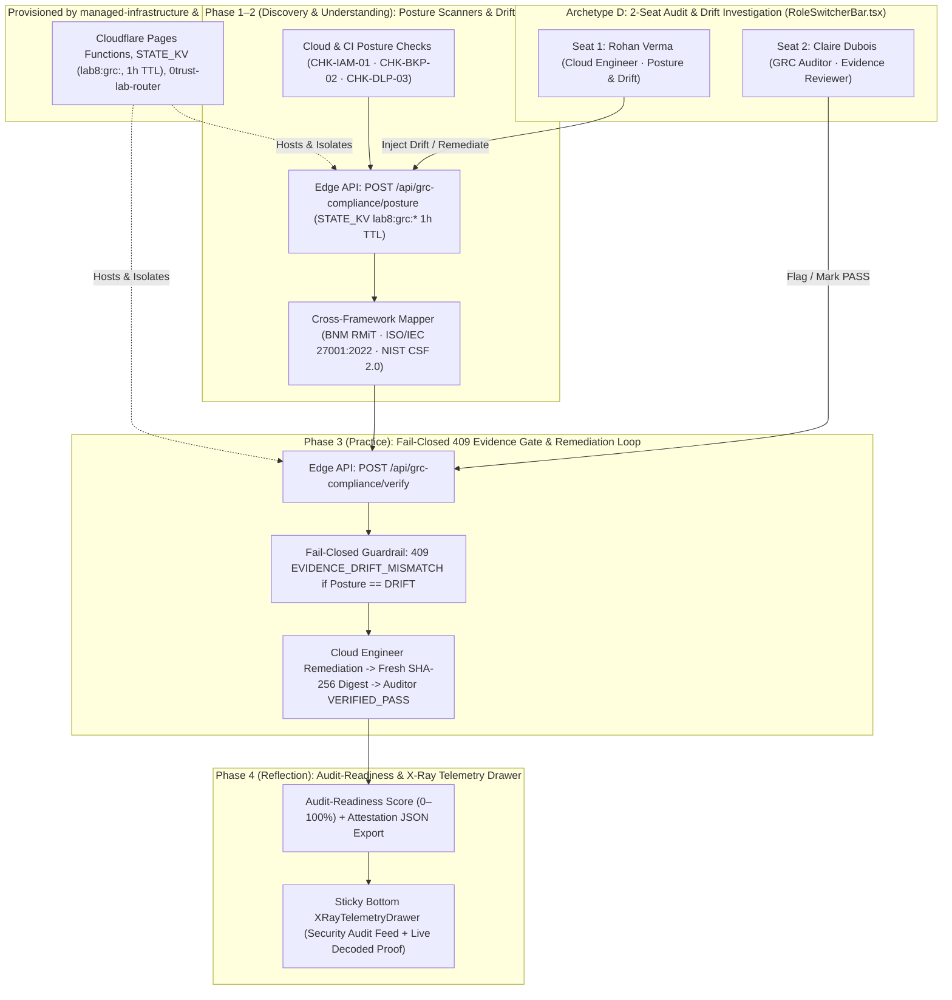

# Lab 8 Architecture: Continuous Compliance & BNM RMiT / ISO 27001 Mapper (`/grc-compliance`)

> **Zoom Level:** 2.5 (Lab Assembly + Infrastructure Mapping)  
> **Parent Overview:** [`0trust.dev/docs/ARCHITECTURE.md`](https://github.com/c2pig/0trust.dev/blob/main/docs/ARCHITECTURE.md)  
> **Experience Archetype:** Archetype D — 2-Seat Audit & Drift Investigation (`Cloud Engineer · Posture & Drift` ↔ `GRC Auditor · Evidence Reviewer`)  
> **Architecture SVG:** [`docs/diagrams/grc_compliance_architecture.svg`](diagrams/grc_compliance_architecture.svg)

---

## 1. End-to-End 2-Seat Continuous Compliance + `managed-infrastructure` Zoom-In

---

## 2. Distributed Repo & Infrastructure Ownership

| Lab Phase & Seat | Plain-English Purpose | Owning Application Repo | Provisioning Infrastructure |
| :--- | :--- | :--- | :--- |
| **Phase 1 (Discovery)**: Posture-to-Regulation Map | Map 3 live posture checks (`CHK-IAM-01`, `CHK-BKP-02`, `CHK-DLP-03`) to BNM RMiT, ISO/IEC 27001:2022, and NIST CSF 2.0 | [`0trust-lab-grc-compliance`](https://github.com/c2pig/0trust-lab-grc-compliance) (`src/contracts/grcComplianceContract.ts`) | `managed-infrastructure/modules/cloudflare-pages-lab` (`enable_custom_domain = false`, behind `0trust-lab-router` at `https://lab.0trust.dev/grc-compliance`) |
| **Phase 2 (Understanding · Seat 1 Cloud Engineer)**: Drift Injection | Inject Drift 8A (`IAM_MFA_BYPASS`), 8B (`BACKUP_WORM_DISABLED`), or 8C (`PII_UNMASKED`) via `POST /api/grc-compliance/posture` | [`0trust-lab-grc-compliance`](https://github.com/c2pig/0trust-lab-grc-compliance) (`functions/api/grc-compliance/posture.ts`) | Cloudflare Pages Functions + `STATE_KV` (`lab8:grc:<sid>`, `1h TTL`) |
| **Phase 3 (Practice · Seat 2 Auditor ↔ Seat 1 Cloud Engineer)**: 409 Trap & Remediation | Enforce fail-closed `409 EVIDENCE_DRIFT_MISMATCH` if Auditor tries `MARK_PASS` while posture is `DRIFT`; remediate & re-verify SHA-256 link | [`0trust-lab-grc-compliance`](https://github.com/c2pig/0trust-lab-grc-compliance) (`functions/api/grc-compliance/verify.ts`, `src/pages/GrcCompliancePage.tsx`) | Cloudflare WebCrypto SHA-256 + `STATE_KV` (`1h TTL`) |
| **Phase 4 (Reflection)**: Attestation Pack & X-Ray Drawer | Compute audit-readiness score, export JSON attestation pack, and inspect raw posture/mapping/SHA-256 proof | [`0trust-lab-grc-compliance`](https://github.com/c2pig/0trust-lab-grc-compliance) (`src/engine/grcComplianceEngine.ts`, `src/components/XRayTelemetryDrawer.tsx`) | `$0.00` Guided Sandbox + `_middleware.ts` W3C `traceparent` |

---

## 3. Security & Evidence Integrity Invariants Enforced

1. **Fail-Closed Auditor Verification (`POST /api/grc-compliance/verify`)**:
   - Attempting `MARK_PASS` while the underlying posture check in `STATE_KV` (`lab8:grc:<sid>`) is `DRIFT` fails closed with **`HTTP 409 EVIDENCE_DRIFT_MISMATCH`**.
2. **Cryptographic SHA-256 Evidence Digests**:
   - Every posture transition and auditor sign-off computes a fresh SHA-256 digest over `(session_id, drift_id, posture_status, timestamp)` via WebCrypto (`crypto.subtle.digest`).
3. **Strict Input Validation & Session Isolation**:
   - `MAX_BODY_BYTES = 65536`, `Set`-based enum validation (`INJECT_DRIFT | REMEDIATE | RESET`, `MARK_PASS | FLAG_REMEDIATION`), `sanitizeSessionId()`, `Cache-Control: no-store`, and `expirationTtl: 3600`.
